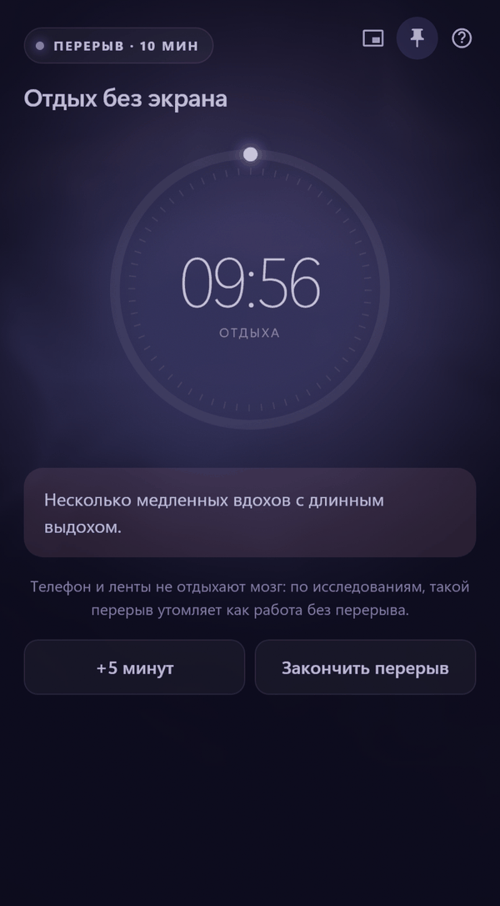

# NZT Focus

[Русский](README.md) | **English**

A research-based focus timer for Windows, built with Tauri 2.

> **The interface is in Russian only for now.** This page is a short English overview; the full description is in the [Russian README](README.md).

<p align="center">
  
  &nbsp;
  
</p>

## Features

- **Focus blocks and breaks.** 60 minutes of work, then a 10–15 minute break; every third break is long, with micro-breaks every 20 minutes.
- **Honest time tracking.** When a block ends, the timer stops. Sleep and shutdown do not count as work.
- **Distraction blocking.** During a block, Focus minimizes YouTube, VK, Instagram, Telegram Web and Yandex Music, and covers the window if you bring it back. You can switch off built-in sites and add your own by domain. In browsers the site is detected by the tab's address.
- **Entry music.** By default a block starts with calm instrumental music from Tabletop Audio: it plays for 2 minutes, fades out evenly and is silent by minute 5. You can also choose silence or music for the whole block.
- **Living background** that slowly flows across the window, plus daily history and a weekly chart.

## Based on research

See the [list of studies behind each feature](docs/research/SOURCES.md) (in Russian, with links to the papers). The reports in [`docs/research`](docs/research) cover focus length, breaks and micro-breaks, and background sound. The short version: music without lyrics lifts mood and helps you get started, but complex thinking goes better in silence.

## Build

Requires [Node.js](https://nodejs.org), [Rust](https://rustup.rs) and WebView2 (included in Windows 10 and 11).

```powershell
cd app
npm install
npx tauri build
```

The installer is created in `app/src-tauri/target/release/bundle/nsis/`.

## Privacy

Everything stays on your computer in `%APPDATA%\app.focus.timer\`. Focus sends nothing anywhere; it only loads tabletopaudio.com when music is playing.

## Music: Tabletop Audio

Music by [Tabletop Audio](https://tabletopaudio.com) (Tim Wright), licensed under [CC BY-NC-ND 4.0](https://creativecommons.org/licenses/by-nc-nd/4.0/). Focus does not store or redistribute tracks: they play through Tabletop Audio's own website and player. If you enjoy the music, support the author on [Patreon](https://www.patreon.com/tabletopaudio).

Focus is a non-commercial project and is not affiliated with Tabletop Audio.

## License

The code is released under the [MIT License](LICENSE). It does not cover Tabletop Audio's music.
