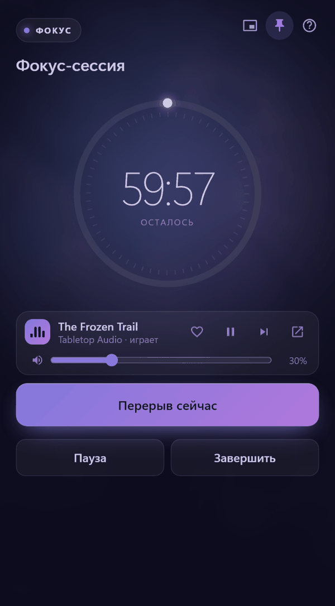
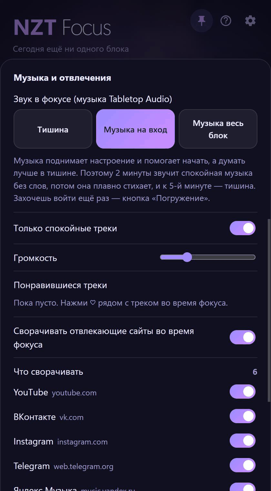

# NZT Focus

[Русский](README.md) | **English**

A research-based focus timer for Windows, built with Tauri 2.

> **The interface is in Russian only for now.** This page is a short English overview; the full description is in the [Russian README](README.md).

<p align="center">
  <a href="https://github.com/proradian/nzt-focus/releases/latest/download/NZT-Focus-setup.exe"></a>
  <br>
  <sub>Windows 10 and 11 · 2 MB installer · <a href="https://github.com/proradian/nzt-focus/releases">all releases</a> · <a href="#safety">safety</a></sub>
</p>

<p align="center">
  
  &nbsp;
  
</p>

## Features

- **Focus blocks and breaks.** 60 minutes of work, then a 10–15 minute break; every third break is long, with micro-breaks every 20 minutes.
- **Honest time tracking.** When a block ends, the timer stops. Sleep and shutdown do not count as work.
- **Distraction blocking.** During a block, Focus minimizes YouTube, VK, Instagram, Telegram Web and Yandex Music, and covers the window if you bring it back. You can switch off built-in sites and add your own by domain. In browsers the site is detected by the tab's address.
- **Entry music.** By default a block starts with calm instrumental music from Tabletop Audio: it plays for 2 minutes, fades out evenly and is silent by minute 5. You can also choose silence or music for the whole block.
- **Living background** that slowly flows across the window, plus daily history and a weekly chart.

## Based on research

See the [list of studies behind each feature](docs/research/SOURCES.md) (in Russian, with links to the papers). The reports in [`docs/research`](docs/research) cover focus length, breaks and micro-breaks, and background sound. The short version: music without lyrics lifts mood and helps you get started, but complex thinking goes better in silence.

## Safety

- **Open source.** Everything the app does is in this repository, and you can build it yourself (below).
- **Virus scan.** [VirusTotal results](https://www.virustotal.com/gui/file/4347774f55111406144a5175a2661b97346400b5de89a69cc3eecab445d9d8d5) — the installer checked by dozens of antivirus engines.
- **Untampered file.** SHA-256 of `NZT-Focus-setup.exe` version 1.0.0:
  `4347774f55111406144a5175a2661b97346400b5de89a69cc3eecab445d9d8d5`
  Check in PowerShell: `Get-FileHash .\NZT-Focus-setup.exe` — the values must match.
- **Windows warning.** The app has no paid code-signing certificate, so Windows may show "Windows protected your PC". Click "More info" → "Run anyway".
- **What it does on your computer.** Stores data only locally in `%APPDATA%\app.focus.timer\`. During a block it reads the title and address of the active browser window to minimize distracting sites. Optionally closes the Yandex Music app. Its only network access is tabletopaudio.com for music.
- **Your own timer instead.** Really worried about viruses? Let an AI write a timer like this for you — [prompt at the end](#prompt-build-your-own-timer).

## Build

Only needed if you want to check the code or change the app; to use it, the Download button above is enough.

Requires [Node.js](https://nodejs.org), [Rust](https://rustup.rs) and WebView2 (included in Windows 10 and 11).

```powershell
cd app
npm install
npx tauri build
```

The installer is created in `app/src-tauri/target/release/bundle/nsis/`.

## Privacy

Everything stays on your computer in `%APPDATA%\app.focus.timer\`. Focus sends nothing anywhere; it only loads tabletopaudio.com when music is playing.

## Music: Tabletop Audio

Music by [Tabletop Audio](https://tabletopaudio.com) (Tim Wright), licensed under [CC BY-NC-ND 4.0](https://creativecommons.org/licenses/by-nc-nd/4.0/). Focus does not store or redistribute tracks: they play through Tabletop Audio's own website and player. If you enjoy the music, support the author on [Patreon](https://www.patreon.com/tabletopaudio).

Focus is a non-commercial project and is not affiliated with Tabletop Audio.

## License

The code is released under the [MIT License](LICENSE). It does not cover Tabletop Audio's music.

## Prompt: build your own timer

Paste this request into ChatGPT, Claude or another AI. You get a single HTML file that opens in a browser, and all of its code can be read.

```text
Build a focus timer as a single HTML file: HTML, CSS and JavaScript in one file, with no external libraries, fonts or network requests, so it opens with a double click in a browser.

It should:
1. Run 60-minute work blocks by default, with 25, 45, 60, 90 minutes or a custom length to choose from. A "What are you working on?" field; the task stays visible during the block.
2. Every 20 minutes, show a gentle 20-second reminder to look into the distance. No pop-ups; it can be skipped.
3. When a block ends, stop the timer and offer a break. A "5 more minutes" button for finishing a thought, but no more than 90 minutes per block.
4. Breaks of 10 minutes, every third one 25 minutes. The break screen shows one screen-free rest idea (walk, look into the distance, stretch, breathe slowly) and a reminder not to pick up the phone.
5. Buttons: pause, break now, finish block. A soft sound at the end of a block and a break (Web Audio, no sound files).
6. Daily history: blocks and minutes today and this week, stored in localStorage. After 4 hours of focus in a day, a gentle "that's enough for today" hint.
7. A calm dark interface with a slow, smooth background, no flashing or sharp animations.

Write clear code with short comments so it can be read and checked.
```
