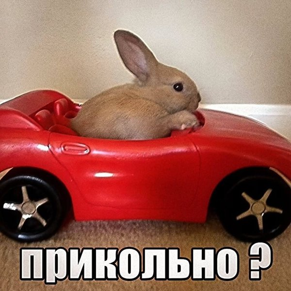
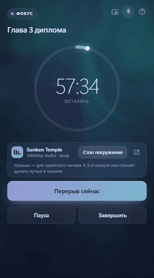
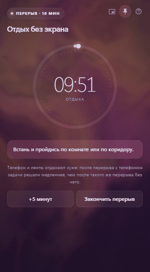
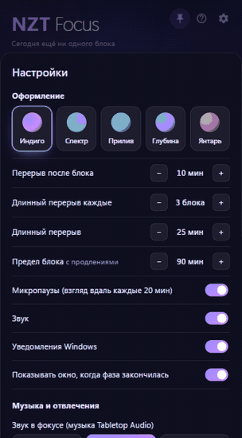

# NZT Focus

**Русский** | [English](README.en.md)

**Вы СДВГшник? И у вас проблемы с вниманием? Но вы хотите быть как Брэдли Купер под НЗТ в «Области тьмы»? У вас так не получится, потому что после интенсива в 10 часов ваш мозг включит защиту, и начнётся бунт. А точнее жесточайшая прокрастинация причем на неделю вперед.**

<p align="center">
  
</p>

Но фильм вдохновил меня сделать приложение для лучшей фокусировки, при этом чтобы приложение не загоняло в жёсткие рамки и не насиловало менталку. Всё тут научно обосновано, даже малейшие детали типа цвета и звука подтверждаются исследованиями и моим субъективным ощущением. За звук отдельное спасибо [Tabletop Audio](https://tabletopaudio.com). Это просто идеальный звук если вы любите фентези.

Софт написан на Claude, потому что такой объём работы с исследованиями и переделками ради незначительной детали типа таймера мог сделать либо сумасшедший человек, либо же миллионы токенов нейросети.

Вы также можете использовать мой промпт в конце для создания своего таймера, если хотите, но я бы не советовал, потому что, очевидно, это займёт много времени с переделками.

Таймер для фокуса, построенный на исследованиях о внимании, перерывах и фоновом звуке.

<p align="center">
  <a href="https://github.com/proradian/nzt-focus/releases/latest/download/NZT-Focus-setup.exe"></a>
  <br>
  <sub>Windows 10 и 11 · установщик 2 МБ · <a href="https://github.com/proradian/nzt-focus/releases">все версии</a> · <a href="#безопасность">безопасность</a></sub>
</p>

<p align="center">
  
  &nbsp;
  
  &nbsp;
  
</p>

## На чём построен NZT Focus

1. **Блок 60 минут и перерыв 10–15 минут.**
   - [Kopardekar & Mital 1994](https://doi.org/10.1080/00140139408964946): в эксперименте с работой оператора за экраном схема «60 минут работы + 10 минут перерыва» дала столько же ошибок, сколько 30/5, и заметно меньше, чем 2 часа без перерыва. Авторы рекомендовали именно 60/10: результат тот же, а прерываний меньше.
   - [Boucsein & Thum 1997](https://doi.org/10.1016/S0169-8141(96)00031-5): при сложной работе за компьютером перерыв после 50 минут лучше снимал умственное и эмоциональное напряжение, чем перерыв после 100 минут.
   - Метаанализ [Wendsche, Lohmann-Haislah & Wegge 2016](https://www.sozialpolitik.ch/article/view/3673), 11 полевых исследований: дополнительные короткие перерывы улучшили и количество, и качество работы, хотя рабочего времени стало меньше. В среднем перерывы в этих исследованиях шли раз в 55 минут.
   - [Руководство MHLW 2019](https://www.mhlw.go.jp/content/000539603.pdf), Япония: не больше часа непрерывной работы за экраном, затем 10–15 минут отдыха. Час выбран потому, что примерно через час растут ошибки ввода и признаки утомления.
   - NIOSH, [Galinsky et al. 2000](https://stacks.cdc.gov/view/cdc/198356) и [2007](https://stacks.cdc.gov/view/cdc/186286): 5 минут отдыха каждый час снизили дискомфорт и усталость глаз без потери выработки, а в 2007 году скорость ввода даже выросла.
   - Метаанализ [Albulescu et al. 2022](https://journals.plos.org/plosone/article?id=10.1371/journal.pone.0272460), N = 2335: перерывы повышают бодрость (d = 0,36) и снижают усталость (d = 0,35), а польза для результата растёт с длиной перерыва. Поэтому перерыв 10–15 минут, а не 5.
   - [Göksu et al. 2026](https://pmc.ncbi.nlm.nih.gov/articles/PMC13405840/), 176 студентов: при схеме «12 минут работы + 3 минуты перерыва» участники называли перерывы сбивающими и просили перерывы длиннее и реже.
   - [Horie 1987](https://doi.org/10.5100/jje.23.373), Япония: лучшей оказалась схема 60/10, но если работать за экраном больше 2 часов в день, после каждого часа желателен перерыв от 15 минут. [Brazaitis et al. 2023](https://www.sciencedirect.com/science/article/abs/pii/S0167876023000612): перерывы по 10 минут каждые 50 минут не уберегли от утомления за 7-часовой день. Поэтому после 2 часов фокуса без длинного отдыха обычный перерыв становится на 5 минут дольше: 10 → 15.
   - У Kopardekar & Mital схемы 30/5 и 60/10 сработали одинаково, то есть важна доля отдыха. Поэтому перерыв зависит от фактической длины блока: 10 минут на час работы, после 45-минутного блока — 8, после 90-минутного — 15 (но не меньше 5 и не дольше длинного перерыва).
   - Длину блока можно поменять: 25, 45, 90 минут, своё время или секундомер без конца.

2. **Мягкие микропаузы каждые 20 минут.**
   - [Руководство MHLW 2019](https://www.mhlw.go.jp/content/000539603.pdf): внутри часа 1–2 короткие паузы, которые работник берёт, когда ему удобно.
   - [McLean et al. 2001](https://doi.org/10.1016/S0003-6870(00)00071-5): микроперерывы снижали дискомфорт без потери выработки, сильнее всего — каждые 20 минут.
   - [Balci & Aghazadeh 2003](https://doi.org/10.1080/0014013021000047557): с микропаузами работали быстрее и точнее, а шея и спина уставали меньше, чем при схеме 60/10 без пауз.
   - [Henning et al. 1997](https://doi.org/10.1080/001401397188396): из частых пауз, которые предлагали работникам, брали около половины. Поэтому в Focus пауза — мягкая подсказка, её можно пропустить.

3. **«Ещё 5 минут» и потолок 90 минут.**
   - [Adamczyk & Bailey 2004](https://www.interruptions.net/literature/Adamczyk-CHI04-p271-adamczyk.pdf) и [Iqbal & Bailey 2008](https://www.interruptions.net/literature/Iqbal-CHI08.pdf): прерывание посреди подзадачи раздражает сильнее, чем в естественной точке остановки. Метаанализ Wendsche et al. 2016 тоже советует давать закончить задачу перед перерывом. Поэтому есть «ещё 5 минут», чтобы дописать мысль.
   - [Lorist et al. 2005](https://doi.org/10.1016/j.cogbrainres.2005.01.018) и [van der Linden et al. 2003](https://doi.org/10.1016/S0001-6918(02)00150-6): после 2 часов трудной работы хуже замечаешь свои ошибки и дольше планируешь. [Boksem et al. 2005](https://doi.org/10.1016/j.cogbrainres.2005.04.011): за 3 часа без отдыха растут пропуски, ложные тревоги и время реакции.
   - [Tucker, Folkard & Macdonald 2003](https://doi.org/10.1016/S0140-6736(03)12566-4) (The Lancet): к концу двух часов непрерывной работы риск несчастного случая вдвое выше, чем в начале.
   - [Biwer et al. 2023](https://doi.org/10.1111/bjep.12593), 87 студентов: без таймера дольше работали без остановки, сильнее уставали и отвлекались.
   - Поэтому продлевать блок можно, но он заканчивается на 90 минутах — с запасом до двухчасовой зоны, где утомление становится заметным.

4. **Длинный перерыв каждые 3 блока и «на сегодня хватит» после 4 часов.**
   - [Boucsein & Thum 1997](https://doi.org/10.1016/S0169-8141(96)00031-5): когда усталость уже накопилась, длинный перерыв снимал её лучше коротких.
   - [Sievertsen, Gino & Piovesan 2016](https://doi.org/10.1073/pnas.1516947113) (PNAS, 2 миллиона тестов датских школьников): результат снижается с каждым часом дня, а перерыв 20–30 минут перекрывает спад примерно за 2 часа.
   - [Hunter & Wu 2016](https://doi.org/10.1037/apl0000045), 95 сотрудников: длинные перерывы восстанавливают лучше, чем редкие короткие.
   - Поэтому длинный перерыв даётся после 3 блоков **подряд**. Пауза между блоками не короче длинного перерыва (обед, уход по делам) сама считается длинным отдыхом, и счёт блоков начинается заново.
   - В счёт идёт блок хотя бы на половину плана: блок, брошенный через 3 минуты, длинный перерыв не приближает.
   - Жёсткого предела в 4 часа никто не нашёл. Цифра идёт от [Ericsson et al. 1993](https://doi.org/10.1037/0033-295X.100.3.363) (дневники 10 + 10 скрипачей, около 4 часов практики в день) и [руководства MHLW](https://www.mhlw.go.jp/content/000539603.pdf) (около 300 минут за экраном в день, со ссылкой на неназванное исследование).
   - Измерен постепенный спад, и сильнее всего он бьёт по трудному. [Brazaitis et al. 2023](https://www.sciencedirect.com/science/article/abs/pii/S0167876023000612): за 7-часовой день ухудшались именно задачи, требующие больших умственных усилий. [Wiehler et al. 2022](https://hal.sorbonne-universite.fr/hal-04534917) (Current Biology): после 6 часов трудной работы, в отличие от лёгкой, люди чаще выбирали то, что не требует усилий. [Linder et al. 2014](https://psnet.ahrq.gov/issue/time-day-and-decision-prescribe-antibiotics) (21 867 приёмов): к 4-му часу смены врачи на 26% чаще выписывали антибиотики, в том числе без показаний.
   - Поэтому после 4 часов фокуса Focus не просит остановиться, а подсказывает: дальше лучше лёгкие задачи или конец дня.

5. **Перерыв без телефона, лучше всего — полный отдых.**
   - [Helton & Russell 2015](https://interruptions.net/literature/Helton-Cognition15.pdf), N = 266 и 521: после 1,8 минуты полного отдыха внимание восстанавливалось, а после другой задачи — нет или хуже.
   - [Kang & Kurtzberg 2019](https://pmc.ncbi.nlm.nih.gov/articles/PMC7044622), N = 414: после перерыва с телефоном задачи решали на 19% дольше и решили на 22% меньше, чем после такого же перерыва без телефона.
   - [Bergouignan et al. 2016](https://pmc.ncbi.nlm.nih.gov/articles/PMC5094084/): шесть 5-минутных прогулок раз в час повысили бодрость и настроение к концу дня.
   - [Lee et al. 2015](https://doi.org/10.1016/j.jenvp.2015.04.003): после 40 секунд взгляда на фото зелёной крыши внимание не проседало, а после фото бетона проседало.
   - Дневной сон: [руководство MHLW по сну 2014](https://www.mhlw.go.jp/file/06-Seisakujouhou-10900000-Kenkoukyoku/0000047221.pdf) и [Takahashi 2003](https://doi.org/10.1053/smrv.2002.0241) — при недосыпе короткий сон до 30 минут в начале второй половины дня снимает сонливость. Поэтому в длинном перерыве после обеда Focus предлагает вздремнуть 15–20 минут.

6. **Задача блока и записка «где я остановился».**
   - [Leroy & Glomb 2018](https://doi.org/10.1287/orsc.2017.1184): короткий план «где остановился и что дальше» снижает остаточное внимание к прерванному делу и улучшает работу над следующим.
   - [Iqbal & Horvitz 2007](https://www.erichorvitz.com/CHI_2007_Iqbal_Horvitz.pdf): по логам сотрудников, задачи, которые оставались на виду, возобновлялись быстрее.

7. **Защита от отвлекающих сайтов, которую настраиваешь сам.**
   - [Mark, Iqbal & Czerwinski 2017](https://www.interruptions.net/literature/Mark-UbiComp17.pdf) и [Mark, Czerwinski & Iqbal 2018](https://www.ics.uci.edu/~gmark/Home_page/Publications_files/CHI%202018%20Workplace%20Distractions.pdf): неделя с блокировщиком подняла фокус, но 16 из 31 отметили больший стресс. Чаще это были люди с высоким самоконтролем, которые перестали делать перерывы. Поэтому сайт сворачивается один раз, есть кнопка «Нужно для работы», а перерывы Focus предлагает сам.
   - [Dabbish, Mark & González 2011](https://www.ics.uci.edu/~gmark/Home_page/Publications_files/CHI%202011%20Self-interruption.pdf): 18% переключений между задачами — самопрерывания, почти столько же, сколько внешних (22%).

8. **Никакой музыки со словами и треков с голосами, для сложной работы — тишина.**
   - Метаанализ [Vasilev et al. 2018](https://eprints.bournemouth.ac.uk/29995/9/1745691617747398.pdf): любой фон слегка ухудшает понимание текста (g = −0,21). Сильнее всего мешают песни со словами (−0,35) и разборчивая речь (−0,34).
   - [Salamé & Baddeley 1989](https://www.gwern.net/doc/music/music-distraction/1989-salame.pdf): вокал и речь, даже на непонятном языке, мешают удерживать цифры в памяти сильнее инструментальной музыки. Мешает звучание речи, а не смысл.
   - [Haapakangas et al. 2011](https://doi.org/10.3813/AAA.918444): речь вокруг ухудшала память, и маски с голосами этого не исправляли. Поэтому из подборки убраны треки с таверной, рынком, городом, праздником и битвой.
   - [Shih et al. 2012](https://www.gwern.net/doc/music/music-distraction/2012-shih.pdf): у 102 студентов песни со словами снизили результат теста внимания, а музыка без слов — незначимо.
   - [Souza & Barbosa 2023](https://doi.org/10.5334/joc.273): песни со словами ухудшили память, а инструментальный lo-fi против тишины эффекта не дал.
   - Метаанализ [Kämpfe et al. 2011](https://www.gwern.net/doc/music/music-distraction/2011-kampfe.pdf) и обзор [Cheah et al. 2022](https://doi.org/10.1177/20592043221134392): в среднем эффект фоновой музыки около нуля, а чтение и память слегка страдают.

9. **Спокойная музыка на вход, затем тишина.**
   - Метаанализ [de Witte et al. 2020](https://doi.org/10.1080/17437199.2019.1627897), 104 рандомизированных исследования: музыка снижает пульс и давление (d = 0,38) и тревогу (d = 0,55), и эффект даёт уже одно прослушивание.
   - [Bernardi, Porta & Sleight 2006](https://doi.org/10.1136/hrt.2005.064600): эффект виден уже за 2 минуты. Медленная музыка расслабляет, а тишина сразу после музыки снижала пульс и дыхание даже ниже исходного уровня.
   - [Lilley, Oberle & Thompson 2014](https://doi.org/10.1037/pmu0000038): после 5 минут спокойной музыки перед тестом пульс и давление были ниже, а баллы выше, чем после неприятной музыки, — у тех, для кого тест был важен.
   - Поэтому блок начинается с 2 минут спокойной музыки без слов, а потом она плавно уходит в тишину, где думать легче всего (пункт 8).
   - [Thompson, Schellenberg & Letnic 2012](https://sites.utm.utoronto.ca/sites/sites.utm.utoronto.ca.glenn_website/files/download/ThompsonEtAl2012.pdf): понимание текста ухудшала только быстрая и громкая музыка. Поэтому громкость по умолчанию 30%.
   - [Huang & Shih 2011](https://gwern.net/doc/psychology/music/distraction/2011-huang.pdf) и [Perham & Sykora 2012](https://gwern.net/doc/psychology/music/distraction/2012-perham.pdf): хуже работали под музыку, которая очень нравится или очень не нравится, и сами этого не замечали. Поэтому треки идут вперемешку, без упора на любимые.
   - [Haake 2011](https://doi.org/10.1177/1029864911398065): люди ценят собственный выбор звука. Поэтому можно выбрать тишину с самого начала или музыку на весь блок.

10. **Медленный тёмный живой фон без вспышек.**
    - [Abrams & Christ 2003](https://doi.org/10.1111/1467-9280.01458) и [Franconeri & Simons 2003](https://visionplus.psych.northwestern.edu/Papers_files/FranconeriSimons_Motion.pdf): внимание захватывают начало движения, внезапное появление и приближение. Поэтому фон течёт медленно, без вспышек, пульса и резких стартов.
    - [Simons, Franconeri & Reimer 2000](https://visionplus.psych.northwestern.edu/Papers_files/Simons_etal_gradual.pdf): плавную смену цвета за 12 секунд люди, специально искавшие изменения, заметили лишь в трети случаев. В Focus цвет меняется ещё медленнее.
    - [Wilms & Oberfeld 2018](https://doi.org/10.1007/s00426-017-0880-8) и [Valdez & Mehrabian 1994](https://doi.org/10.1037/0096-3445.123.4.394): насыщенные и яркие цвета сильнее возбуждают. Поэтому фон тёмный и не отвлекает.
    - [Mullen & Kingdom 2002](https://doi.org/10.1017/S0952523802191103): различие синего и жёлто-оранжевого хорошо видно даже краем глаза. Поэтому фокус синий, а перерыв тёплый: фазу видно, не глядя на цифры.

Подробности, оговорки и пометки, что сверено по полному тексту, а что по аннотации, — в [списке исследований](docs/research/SOURCES.md) и отчётах [«Фокус и перерывы в работе»](docs/research/reports/Фокус%20и%20перерывы%20в%20работе.md) и [«Музыка и звук при работе»](docs/research/reports/Музыка%20и%20звук%20при%20работе.md).

## Безопасность

- **Код открыт.** Всё, что делает программа, лежит в этом репозитории, и её можно [собрать самому](#собрать-самому).
- **Проверка на вирусы.** [Результаты VirusTotal](https://www.virustotal.com/gui/file/ab01fcf1c1373e3c22f09f8e270e66f57e9027fdc01eefc82d80b5190a5696b3) — установщик проверен десятками антивирусов.
- **Файл не подменён.** Контрольная сумма SHA-256 установщика `NZT-Focus-setup.exe` версии 1.0.0:
  `ab01fcf1c1373e3c22f09f8e270e66f57e9027fdc01eefc82d80b5190a5696b3`
  Проверить в PowerShell: `Get-FileHash .\NZT-Focus-setup.exe` — значения должны совпасть.
- **Что программа делает на компьютере.** Хранит данные только у вас, в `%APPDATA%\app.focus.timer\`. Во время блока смотрит заголовок и адрес активного окна браузера, чтобы свернуть отвлекающие сайты. По желанию закрывает приложение Яндекс Музыки. В сеть ходит только на tabletopaudio.com за музыкой.
- **Свой таймер вместо этого.** Очень боитесь вирусов? Пусть нейросеть напишет такой таймер для вас — [промпт в конце](#промпт-свой-таймер).

## Собрать самому

Это нужно, только если хотите проверить код или изменить программу. Чтобы просто пользоваться, достаточно кнопки «Скачать» вверху.

Нужны [Node.js](https://nodejs.org), [Rust](https://rustup.rs) и WebView2 (в Windows 10 и 11 уже есть).

```powershell
cd app
npm install
npx tauri build
```

Установщик появится в `app/src-tauri/target/release/bundle/nsis/`. Для разработки: `npx tauri dev`.

Интерфейс можно посмотреть и в обычном браузере (`python -m http.server --directory app/src`), только без нативных функций: музыки, защиты и трея.

## Структура

| Путь | Что это |
|---|---|
| `app/src/` | Интерфейс: HTML, CSS и JS без сборщика |
| `app/src-tauri/src/` | Нативная часть на Rust: окно, трей, хранение данных, защита от отвлечений (`guard.rs`, `urlbar.rs`, `curtain.rs`), музыка (`tta.rs`) |
| `docs/research/` | Исследования, на которых основан Focus |
| `docs/screenshots/` | Скриншоты для README |

## Данные

Всё хранится только на вашем компьютере, в `%APPDATA%\app.focus.timer\`. Focus ничего никуда не отправляет. Из сети он загружает только сайт tabletopaudio.com, когда играет музыка.

## Музыка: Tabletop Audio

Музыка — [Tabletop Audio](https://tabletopaudio.com) (автор Tim Wright), лицензия [CC BY-NC-ND 4.0](https://creativecommons.org/licenses/by-nc-nd/4.0/). Focus не хранит и не распространяет треки: они играют через собственный сайт и плеер Tabletop Audio, а Focus только управляет воспроизведением. Проект живёт на поддержке слушателей. Если музыка нравится, поддержите автора на [Patreon](https://www.patreon.com/tabletopaudio).

Focus — некоммерческий проект и никак не связан с Tabletop Audio.

## Лицензия

Код распространяется по лицензии [MIT](LICENSE). Она не распространяется на музыку Tabletop Audio.

## Промпт: свой таймер

Скопируйте этот запрос в ChatGPT, Claude или другую нейросеть. Получится один HTML-файл, который открывается в браузере, и весь его код можно прочитать. Учтите: в браузере не получится сворачивать отвлекающие сайты и программы, держать окно поверх всех окон и сидеть в трее, а вместо музыки Tabletop Audio будет звук, сгенерированный самой страницей. С первого раза результат будет проще NZT Focus, доводить его придётся несколькими уточнениями.

```text
Сделай таймер фокуса в виде одного HTML-файла: HTML, CSS и JavaScript в одном файле, без внешних библиотек, шрифтов и запросов в интернет, чтобы он открывался двойным щелчком в браузере. Интерфейс на русском. Пиши код понятно, с короткими комментариями, чтобы его можно было прочитать и проверить.

БЛОК РАБОТЫ
- По умолчанию 60 минут; на выбор 25, 45, 60, 90 минут или своё время. Поле «Над чем работаешь?» (необязательно), задача видна во время блока.
- Кнопки: пауза, перерыв сейчас, завершить.
- Считай только время работы: если компьютер спал или страница была закрыта, этот промежуток работой не считается (сравнивай реальное время между тиками и сохраняй состояние в localStorage).

МЯГКИЙ КОНЕЦ БЛОКА
- Когда время вышло, таймер замирает на плановом времени, звучит тихий сигнал и появляется предложение перерыва.
- Если человек дописывает мысль и нажимает кнопку в течение 10 минут, эти минуты засчитываются в блок.
- Кнопка «Ещё 5 минут» продлевает блок, но не дольше 90 минут на блок.
- Если 15 минут нет ответа, блок закрывается сам ровно на плановом времени.

МИКРОПАУЗЫ
- Каждые 20 минут блока — мягкая плашка на 20 секунд: «Отведи взгляд вдаль, расслабь плечи». Без всплывающих окон, её можно закрыть.

ПЕРЕРЫВ
- 10 минут на час работы: после короткого блока меньше, после длинного больше (не меньше 5 минут). Если с последнего длинного отдыха набралось 2 часа фокуса — на 5 минут дольше, и на экране перерыва сказано почему.
- После каждых трёх блоков подряд — 25 минут. Если между блоками прошло 25 минут и больше, это уже длинный отдых: счёт блоков начинается заново. Блок, завершённый без перерыва, тоже идёт в счёт, если длился хотя бы половину плана.
- Кнопки «+5 минут» и «Закончить перерыв».
- На экране перерыва — одна случайная идея отдыха без экрана.
  Короткие: пройдись по комнате; посмотри в окно на что-нибудь далёкое; потянись; выпей воды не за столом; несколько медленных вдохов с длинным выдохом; посмотри секунд сорок на что-нибудь зелёное.
  Длинные: выйди на улицу; поешь не за столом и без экрана; поговори с кем-нибудь не о работе; короткая прогулка или разминка. С 12:30 до 15:00 добавь к длинному перерыву: «можно вздремнуть 15–20 минут, но не дольше 30».
- Строка внизу: после перерыва с телефоном задачи решают медленнее, чем после такого же перерыва без него.
- «Перерыв сейчас» посреди блока: сначала поле «Где ты остановился?» (одна строка, необязательно), потом 5 минут перерыва, затем блок продолжается, а записка видна рядом с задачей.

ЗВУК
- Три режима на главном экране: «Тишина», «Звук на вход» (по умолчанию), «Звук весь блок».
- Звук — спокойный фон без мелодии и слов, сгенерированный через Web Audio (мягкий аккорд или шум, похожий на дождь), без звуковых файлов.
- «Звук на вход»: первые 2 минуты блока звучит фон, потом за 3 минуты он стихает равномерно по децибелам — от 0 до −40 дБ, то есть множитель громкости 10^(−40·x/20), где x идёт от 0 до 1. К 5-й минуте тишина. Не убавляй амплитуду линейно: так спад сначала не слышен, а в конце звук резко пропадает.
- Время входа — минуты работы без пауз. Кнопка «Стоп погружения» гасит звук плавно за 2 секунды, кнопка «Погружение» запускает вход заново с текущей минуты.
- Громкость по умолчанию 30%, ползунок в настройках.

ИСТОРИЯ
- Каждый блок сохраняй в localStorage: дата, задача, минуты.
- На главном экране: сколько сегодня блоков и минут и график за 7 дней — столбики по дням с подписью часов.
- После 4 часов фокуса за день — мягкая подсказка «на сегодня хватит»: это ориентир, а не запрет.

ЖИВОЙ ФОН
- Медленный перелив цвета на всё окно (canvas или CSS-градиенты): в фокусе холодные цвета (синий, бирюзовый, фиолетовый), в перерыве тёплые. Один цвет перетекает в соседний примерно за минуту.
- Без вспышек, пульсации и резких стартов анимации: внимание цепляет именно начало движения. Учитывай prefers-reduced-motion.
- Тёмный спокойный интерфейс, крупный таймер в кольце прогресса.

ТЕКСТЫ
- Не обещай рост продуктивности и не используй популярные мифы (внимание как у золотой рыбки, 90-минутные циклы, правило 52/17). Говори о меньшей усталости и спокойном ритме. Пиши коротко и на «ты».

ЧЕГО НЕ ДЕЛАТЬ
- В браузере нельзя сворачивать другие окна и сайты, держать окно поверх всех окон и работать из трея. Не пытайся это сделать и не имитируй.
```
