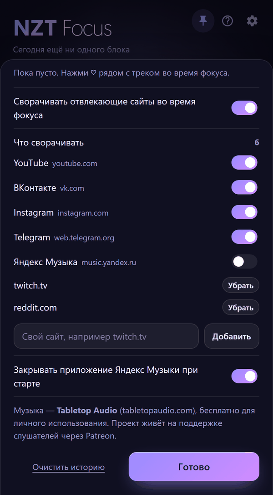

# NZT Focus

**Русский** | [English](README.en.md)

Таймер фокуса для Windows, построенный на исследованиях о внимании, перерывах и фоновом звуке.

<p align="center">
  
  &nbsp;
  
</p>

## Что умеет

- **Блоки работы и перерывы.** По умолчанию 60 минут работы и 10–15 минут перерыва, каждый третий перерыв длинный, микропаузы каждые 20 минут. Если не дописал мысль, есть «ещё 5 минут», но не дольше 90 минут на блок.
- **Честный учёт времени.** Когда блок кончился, таймер замирает. Сон компьютера работой не считается.
- **Защита от отвлечений.** Во время блока Focus сворачивает YouTube, ВКонтакте, Instagram, Telegram Web и Яндекс Музыку. Если окно развернуть обратно, поверх него ляжет занавес. Список можно менять: встроенные сайты выключаются, свои добавляются по адресу (`twitch.tv`, `reddit.com`). В браузере сайт узнаётся по адресу вкладки, а кнопка «Нужно для работы» разрешает его до конца блока.
- **Музыка на вход.** По умолчанию блок начинается со спокойной музыки без слов от Tabletop Audio: 2 минуты она звучит, потом плавно стихает, и к 5-й минуте наступает тишина. Музыка делает начало приятнее, а сложная работа идёт в тишине. Кнопка «Стоп погружения» выключает музыку раньше, а «Погружение» запускает вход заново. Можно выбрать и тишину с самого начала, и музыку на весь блок. В музыке отфильтрованы треки с голосами и шумом толпы, понравившиеся треки сохраняются.
- **Живой фон.** Цвет медленно переливается на всё окно: в фокусе холодные цвета, в перерыве тёплые. Под музыку перелив следует за звуком.
- **История по дням** и недельный график.
- Мини-плашка, окно поверх всех окон, иконка в трее, уведомления Windows.

## На чём основано

**[Список исследований и что из них взято в таймер](docs/research/SOURCES.md).** Отчёты лежат в [`docs/research/reports`](docs/research/reports), заметки, из которых они собраны, — в [`docs/research/notes`](docs/research/notes):

- [Фокус и перерывы в работе](docs/research/reports/Фокус%20и%20перерывы%20в%20работе.md): длительность фокуса, перерывы и микропаузы.
- [Музыка и звук при работе](docs/research/reports/Музыка%20и%20звук%20при%20работе.md). Вывод: для сложного мышления лучше тишина, а музыка без слов вредит меньше всего и помогает настроению и рутине.

## Сборка

Нужны [Node.js](https://nodejs.org), [Rust](https://rustup.rs) и WebView2 (в Windows 10 и 11 уже есть).

```powershell
cd app
npm install
npx tauri build
```

Установщик появится в `app/src-tauri/target/release/bundle/nsis/`. Для разработки: `npx tauri dev`.

Интерфейс можно посмотреть и в обычном браузере (`python -m http.server --directory app/src`), только без нативных функций: музыки, защиты и трея.

## Структура

| Путь | Что это |
|---|---|
| `app/src/` | Интерфейс: HTML, CSS и JS без сборщика |
| `app/src-tauri/src/` | Нативная часть на Rust: окно, трей, хранение данных, защита от отвлечений (`guard.rs`, `urlbar.rs`, `curtain.rs`), музыка (`tta.rs`) |
| `docs/research/` | Исследования, на которых основан Focus |
| `docs/screenshots/` | Скриншоты для README |

## Данные

Всё хранится только на вашем компьютере, в `%APPDATA%\app.focus.timer\`. Focus ничего никуда не отправляет. Из сети он загружает только сайт tabletopaudio.com, когда играет музыка.

## Музыка: Tabletop Audio

Музыка — [Tabletop Audio](https://tabletopaudio.com) (автор Tim Wright), лицензия [CC BY-NC-ND 4.0](https://creativecommons.org/licenses/by-nc-nd/4.0/). Focus не хранит и не распространяет треки: они играют через собственный сайт и плеер Tabletop Audio, а Focus только управляет воспроизведением. Проект живёт на поддержке слушателей. Если музыка нравится, поддержите автора на [Patreon](https://www.patreon.com/tabletopaudio).

Focus — некоммерческий проект и никак не связан с Tabletop Audio.

## Лицензия

Код распространяется по лицензии [MIT](LICENSE). Она не распространяется на музыку Tabletop Audio.
